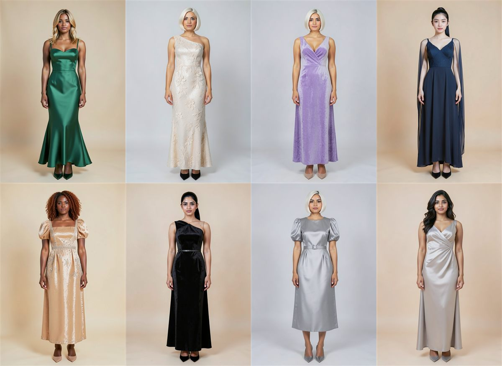
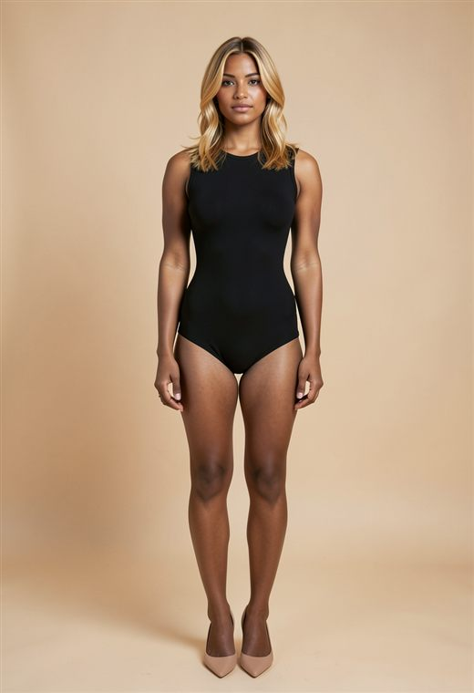
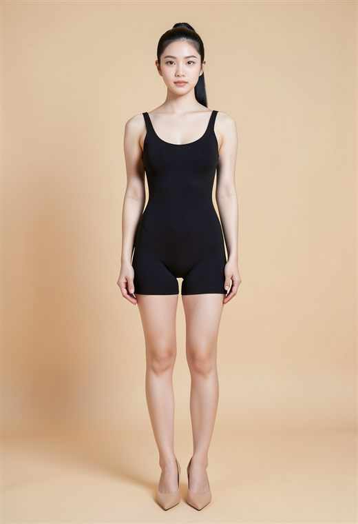
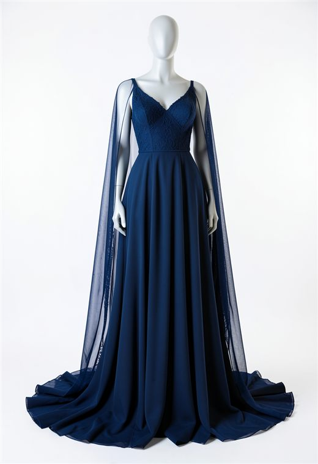
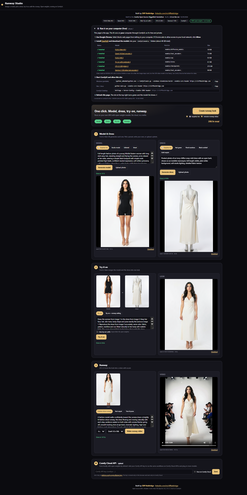
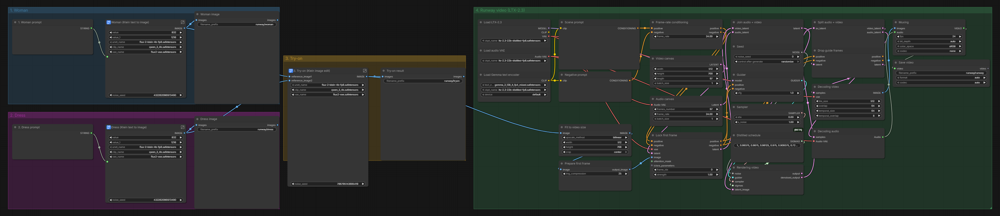

# Runway Studio

**Live app: https://cliffbaldridge.com/runway-studio/** · **[⬇ Download zip](https://cliffbaldridge.com/runway-studio/runway-studio.zip)** · **[⬇ ComfyUI master workflow](comfyui_master_workflow.json)**

An open-source virtual try-on and runway video app built on ComfyUI, using open-weight models only.

| Model | Dress | Try-on | Runway video |
|---|---|---|---|
|  |  |  | [▶ set1-runway.mp4](media/set1-runway.mp4) |
|  |  |  | [▶ set2-runway.mp4](media/set2-runway.mp4) |

All of these were rendered on a laptop RTX 3080: about 10–30 seconds per image and about 2 minutes per video.

### The full app, one click

A full **✨ Create runway look** run on the live site, connected to a local ComfyUI: model, dress, try-on and runway video in **208.9 seconds** total.

1. **Model & Dress**: FLUX.2 Klein 4B generates a full-length model and a dress from one-click presets, your own prompt, 🎲 Surprise me, or an uploaded photo.
2. **Try it on**: FLUX.2 Klein puts the dress on the model, using both images as references. An optional open try-on LoRA is one checkbox away.
3. **Runway**: LTX-2.3 turns the look into a short runway video with sound.

**✨ Create runway look** runs all three in one click: about 50 seconds for the images and about 2 minutes for the video on a laptop RTX 3080.

Built by **Cliff Baldridge** · [linkedin.com/in/cliffbaldridge](https://www.linkedin.com/in/cliffbaldridge/)

Built for the Comfy *Open Source Higgsfield* Hackathon. Built at AI on the Lot, 10/29/2026.

## Two ways to run it

### 1. Hybrid: the hosted page plus your own ComfyUI

Open **https://cliffbaldridge.com/runway-studio/** in **Google Chrome**. The page runs the AI on *your* computer through ComfyUI, so it's free and private.

1. Install [ComfyUI](https://www.comfy.org/download) and download the models listed below.
2. Start ComfyUI and allow the site:
   - Windows portable: `.\python_embeded\python.exe -s ComfyUI\main.py --windows-standalone-build --enable-cors-header https://cliffbaldridge.com`
   - Mac / Linux: `python main.py --enable-cors-header https://cliffbaldridge.com`
   - ComfyUI Desktop: Settings → Server-Config → Enable CORS header: `https://cliffbaldridge.com`
3. Refresh the page. The status dot turns green, and the setup panel shows each model as ✓ Installed or Missing along with your GPU.

Use Chrome: Safari blocks web pages from talking to `127.0.0.1`. If Chrome asks to allow access to your local network, click **Allow**.

No GPU? Add a Comfy API key in the **Comfy Cloud API** panel at the bottom of the page (experimental).

### 2. Local plugin: the app served by ComfyUI itself

1. Copy this folder into `ComfyUI/custom_nodes/comfyui-runway-studio`.
2. Start ComfyUI normally and open **http://127.0.0.1:8188/studio/**. No CORS flag is needed because the page and ComfyUI share one address.

## Models

| Folder in `ComfyUI/models/` | File | Size | Download |
|---|---|---|---|
| `diffusion_models` | `flux-2-klein-4b-fp8.safetensors` | 3.8 GB | [black-forest-labs/FLUX.2-klein-4b-fp8](https://huggingface.co/black-forest-labs/FLUX.2-klein-4b-fp8) |
| `text_encoders` | `qwen_3_4b.safetensors` | 7.5 GB | [Comfy-Org/flux2-klein](https://huggingface.co/Comfy-Org/flux2-klein) |
| `vae` | `flux2-vae.safetensors` | 0.3 GB | [Comfy-Org/flux2-dev](https://huggingface.co/Comfy-Org/flux2-dev) |
| `loras` (optional) | `tryon-klein-4b.safetensors` | 0.1 GB | [xocialize/tryon-FLUX.2-klein-4B-lora](https://huggingface.co/xocialize/tryon-FLUX.2-klein-4B-lora) |
| `checkpoints` | `ltx-2.3-22b-distilled-fp8.safetensors` | 27.5 GB | [Lightricks/LTX-2.3-fp8](https://huggingface.co/Lightricks/LTX-2.3-fp8) |
| `text_encoders` | `gemma_3_12B_it_fp4_mixed.safetensors` | 8.8 GB | [Comfy-Org/ltx-2](https://huggingface.co/Comfy-Org/ltx-2) |

The video step needs an NVIDIA GPU with 16 GB of VRAM or more. On a Mac, the image steps work, but the 22B video model is very slow.

## How it works

The app is plain HTML, CSS and JavaScript (`index.html`, `assets/`). For each step it:

1. loads an API-format workflow from `workflows/`
2. fills in `{{PLACEHOLDERS}}` (prompt, seed, images, size)
3. sends it to ComfyUI's `/api/prompt`
4. tracks progress over the ComfyUI websocket
5. shows the result from `/api/view`

| Step | Workflow file | Placeholders |
|---|---|---|
| Model / Dress | `workflows/klein_generate.json` | `PROMPT`, `SEED`, `WIDTH`, `HEIGHT` |
| Try it on | `workflows/klein_merge.json` | `PROMPT`, `SEED`, `IMAGE_1` (model), `IMAGE_2` (dress) |
| Try it on (LoRA) | `workflows/klein_tryon_lora.json` | same as above |
| Runway | `workflows/ltx_runway.json` | `PROMPT`, `SEED`, `IMAGE_1` (look), `WIDTH`, `HEIGHT`, `FRAMES`, `FPS` |

`comfyui_master_workflow.json` is the whole pipeline as one ComfyUI graph. Drag it into ComfyUI to see or run every step together.

To swap in your own workflow:
1. In ComfyUI, use **Export (API)**.
2. Replace the matching file in `workflows/`.
3. Put the placeholders above in the widget values, for example set the prompt text to `{{PROMPT}}`.

`__init__.py` is a tiny ComfyUI custom node that adds no nodes. It only serves this folder at `/studio/`.

## Privacy

- Comfy API keys are stored only in your browser's local storage, never in the code or this repo.
- In hybrid mode, images go straight from your browser to your own ComfyUI.

## Licenses

- App code: MIT (see `LICENSE`).
- FLUX.2 Klein 4B, Qwen3 4B and the try-on LoRA: Apache 2.0.
- LTX-2.3 and Gemma 3: see the license on each model page.
- Generated media follows each model's terms.
